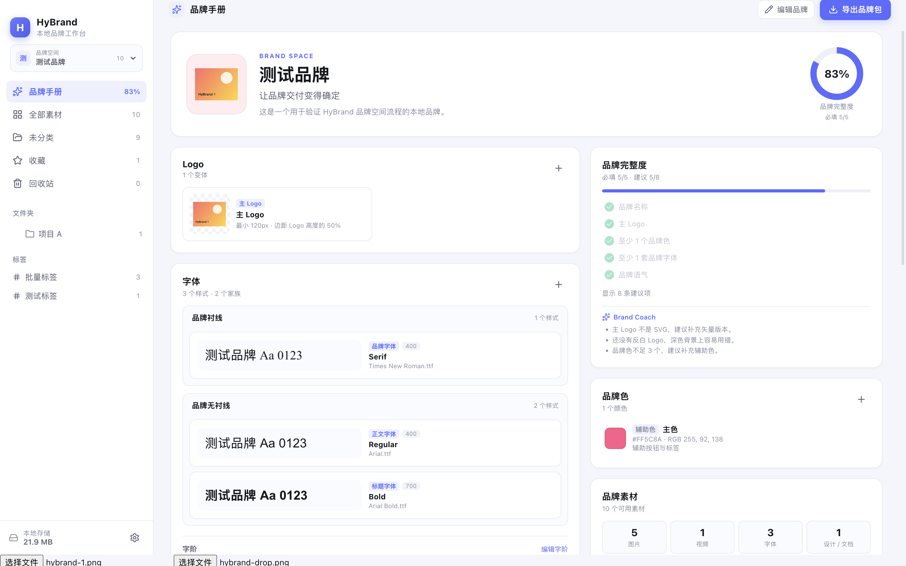
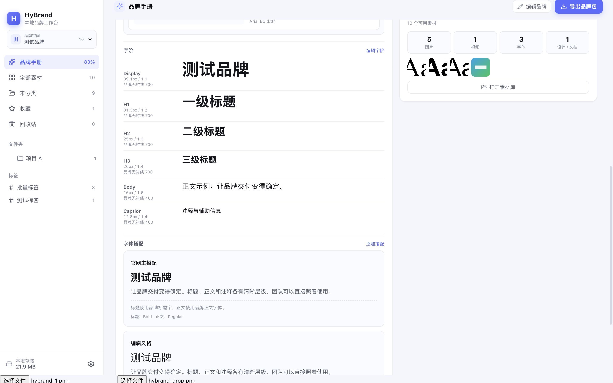
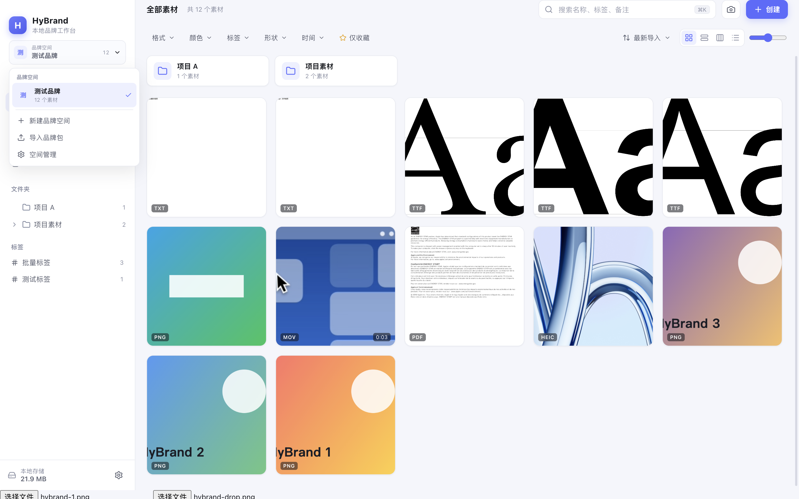
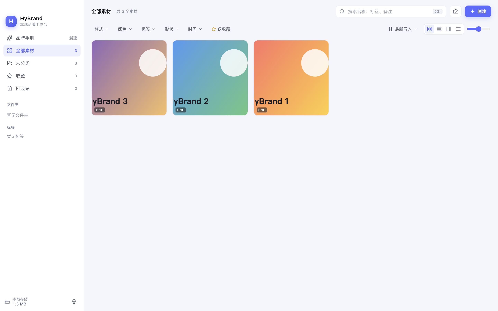
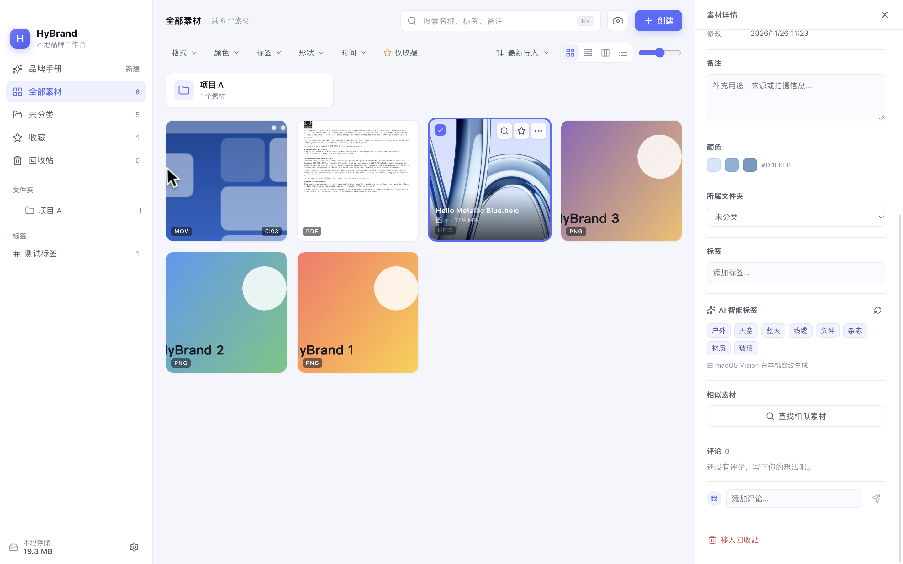

# HyBrand

HyBrand 是面向品牌 / 设计团队的**本地优先 AI 品牌资产工作台**。它把散落的素材变成可被 AI 理解、按品牌规范使用、可直接交付的品牌系统，并且所有数据默认留在本机。

核心方向：**品牌工作的确定性——找得到、用得对、交得出、数据守得住。**

当前版本：**v0.8.0（Local / Phase 1）**。







## 产品方向：一套核心，三种交付

HyBrand 不是三个产品，而是同一套品牌核心的三种形态：

| 形态 | 目标用户 | 核心价值 | 数据位置 |
| --- | --- | --- | --- |
| **HyBrand Local** | 独立设计师、小工作室、隐私敏感团队 | 本地 AI 品牌工作台，离线可用、无需账号 | Mac 本地 |
| **HyBrand Cloud（SaaS）** | 品牌团队、agency、跨地域协作 | 协作、分享链接、审批、品牌门户、分析 | 云端租户 |
| **HyBrand Private** | 大品牌、金融、政府、强合规企业 | SaaS 能力 + 数据驻留 + 私有 AI + 审计 | 客户机房 |

三版共享 Brand Core：品牌空间、资产库、规范块、Checklist、搜索、版本、状态、导出、AI 结果。  
差异只在外壳：存储、账号、权限、协作与部署方式。

当前 Local 版已落地“品牌空间 + 规范块 + 完整度 + 品牌包导出”；后续 SaaS / 私有化路线见 [ROADMAP.md](ROADMAP.md)。

## 当前能力（Local v0.8.0）

### 品牌空间（Phase 1 新增）

- **多品牌空间**：侧栏切换；支持创建、重命名、删除；每个空间拥有独立的素材库、文件夹、标签、回收站和品牌手册
- **品牌首页**：Bento 布局的品牌空间，展示品牌名称、定位、简介、主 Logo、完整度
- **Logo 规范块**：主 Logo / 反白 / 单色 / 横版 / 竖版 / 图标；支持最小宽度、安全边距、使用说明
- **品牌色**：角色（主色 / 辅助 / 强调 / 中性 / 背景 / 文字）、使用场景、HEX / RGB / HSL / CMYK / Pantone、全格式一键复制、WCAG 对比度检查、从素材色板取色
- **字体规范块**：多字体家族分组，同一家族支持多个字重/样式；本地 `@font-face` 样张、字体文件下载
- **字体系统**：基准字号 × 比例生成 6 级字阶；每一级可单独指定字体与字重；支持多套标题 / 正文搭配规则
- **品牌语气**：可持续编辑的品牌表达原则
- **品牌完整度**：必填 / 建议项检查 + **Brand Coach** 本地建议（缺反白 Logo、缺 SVG、品牌色不足等）
- **品牌包导出**：生成 `index.html` 品牌手册 + `brand.json` + `logos/` + `fonts/`，完全离线、可直接分享
- **品牌包导入**：选择 HyBrand 导出的品牌包文件夹，自动创建新品牌空间，并恢复 Logo、颜色、字体、字阶与字体搭配
- **素材概览**：品牌相关素材数量与最近素材入口

### 产品手册（Phase 1 新增）

- **一个品牌，多个产品**：产品挂在品牌空间下，每个品牌空间独立管理自己的产品，互不串数据
- **产品手册**：产品信息、产品 Logo、产品色、产品字体、产品素材文件夹与使用规范
- **继承 + 覆盖**：产品默认继承品牌字体，也可以为单个产品指定标题 / 正文字体
- **产品素材**：把一个产品相关的素材收进文件夹，产品手册直接读取该文件夹及子文件夹
- **产品索引**：搜索、状态筛选（概念 / 待上市 / 在售 / 已归档），展示完整度与产品色
- **产品完整度**：必填 / 建议项检查 + Product Coach 建议，支持从检查项直接补全
- **产品手册导出**：一键生成离线 `index.html` + `product.json` + 产品素材原文件 + 预览图
- **产品手册导入**：选择由 HyBrand 导出的产品手册目录，在当前品牌空间恢复产品、Logo、产品色、字体与素材文件夹；目标品牌缺少对应字体时自动回退为继承品牌字体
- 产品手册目前独立导出 / 导入，暂不随品牌包一起打包，也不生成 PDF（见 Roadmap）

### 素材库与本地 AI

- 拖拽 / 文件选择 / 文件夹上传；文件夹保留本地目录结构，同名文件夹自动合并
- SHA-256 去重；重复文件会在当前文件夹自动生成快捷链接（不复制、不占用额外存储），可直接打开源文件 / 在 Finder 中显示，也可单独移除链接；回收站中的文件不参与去重，重新导入会生成新的可见素材
- 图片、视频、音频、PDF、PSD/AI/Sketch、3D、字体等
- QuickLook / ImageIO 缩略图，HEIC、PDF、视频封面可显示真实画面
- macOS Vision 本地 AI：自动标签、相似素材、以图搜图；零模型下载、零上传
- 网格 / 自适应 / 瀑布流 / 列表四种视图，缩略图尺寸调节
- 文件夹、未分类、收藏、回收站、标签、评论
- 文件名 / 备注 / 标签 / AI 标签搜索；格式、颜色、标签、形状、时间筛选
- 批量收藏、移动、打标签、回收站；多选与键盘操作





## 快速开始

要求：macOS 14+、Node.js 22+、Swift 6（Xcode Command Line Tools 即可）。

```bash
npm install
npm run build:vision   # 编译本地 AI 助手
npm run dev            # Vite + Electron
```

打包：

```bash
npm run build          # Vision + 渲染层构建
npm run dist           # 生成 dist-app/mac-arm64/HyBrand.app 与 .dmg
```

构建产物：

- `dist-app/mac-arm64/HyBrand.app`
- `dist-app/HyBrand-0.8.0-arm64.dmg`

应用为本地 ad-hoc 签名；如 Gatekeeper 拦截，请在 Finder 中右键选择「打开」。

## 数据位置

```text
~/Library/Application Support/HyBrand/
├─ library.json        # 素材、文件夹、品牌空间、评论和设置
├─ files/              # 原始文件副本
├─ previews/           # 缩略图 / 预览图
├─ features/           # Vision 特征向量
└─ session/            # Chromium 会话缓存
```

品牌空间数据存放在 `library.json` 的 `spaces[]` 字段：每个空间拥有独立的 Logo 变体、品牌色、字体角色、语气与完整度依据；产品手册存放在每个空间的 `products[]` 字段。  
备份时退出应用后复制整个 `HyBrand` 目录即可。测试可用 `HYBRAND_DATA_DIR=/path/to/tmp` 隔离数据。

## 快捷键

| 快捷键 | 功能 |
| --- | --- |
| `⌘K` | 聚焦搜索；品牌页内返回素材库并聚焦搜索 |
| `⌘O` | 导入文件 |
| `⌘⇧O` | 上传文件夹 |
| `⌘⇧N` | 新建文件夹 |
| `⌘,` | 设置 |
| `Space` / `Enter` | 全屏预览选中素材 |
| `←` / `→` | 切换选中素材 |
| `⌘A` | 全选当前结果 |
| `Delete` | 移入回收站（回收站内为彻底删除确认） |
| `Esc` | 关闭预览 / 弹窗 / 清除选择 / 清除搜索 |
| 滚轮（预览内） | 缩放图片 |

## 技术结构

- Electron 45 + React 19 + Vite 8 + zustand + lucide-react
- `electron/`：本地索引、导入流水线、Range 媒体协议、IPC、Vision 调用、品牌包导出
- `vision/HyBrandVision.swift`：ImageIO + Vision + AVFoundation 本地分析助手
- `renderer/`：素材库、品牌空间、规范块、弹窗与状态
- 数据：本地 JSON + 文件目录；AI 全部在本机完成

## 当前边界

Local v0.8.0 不包含多人协作、分享链接、角色权限、SSO、版本历史、看板视图、批量重命名、云端同步、对话式语义搜索；产品手册支持独立导出 / 导入，但暂不随品牌包一起打包，也不生成独立 PDF。  
这些能力属于后续 SaaS / 私有化阶段，或者需要额外模型；路线与架构前置原则见 [ROADMAP.md](ROADMAP.md)。

## 说明

产品形态参考 MuseDAM 与 Brandy 的公开产品能力；HyBrand 的代码、图标与视觉资产均为独立实现，不包含其商标、素材或源代码。
